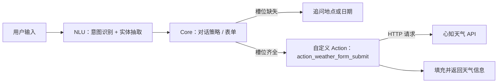

# 天气查询机器人（Rasa 中文任务型对话机器人）

基于 **Rasa 3.1** 的中文天气查询对话机器人：用户用自然语言说出「城市 + 日期」，机器人通过意图识别与实体抽取完成槽位填充，再调用心知天气 API 返回今天 / 明天 / 后天的天气信息。

## 功能特性

- **意图识别**：打招呼、再见、问身份、查天气（`greet` / `goodbye` / `who_are_you` / `ask_weather`）
- **实体抽取**：从自然语言中抽取 `location`（城市）和 `date`（日期）两个实体
- **槽位填充（表单）**：`weather_form` 表单收集缺失槽位，缺城市或日期时自动追问
- **多轮对话**：基于 Rasa Core 对话策略管理多轮上下文
- **同义词识别**：`今日 / 当日 / 本日` → 今天，`明日 / 第二天` → 明天，`两天后` → 后天
- **外部 API 调用**：自定义 Action 请求心知天气 `daily.json` 接口，返回结构化天气
- **兜底处理**：`action_fallback` 在意图不明确时反问用户，避免答非所问

## 对话流程



示例：

```
用户：明天北京的天气
机器人：北京 明天的天气：
        白天：晴
        夜晚：多云
        最高温度：12℃
        最低温度：3℃
        降水概率：0%
        风向：西北风
        风力：3级
        湿度：45%
```

## 目录结构

```text
天气查询机器人/
├── actions/                      # 自定义 Action 代码
│   ├── __init__.py
│   ├── actions.py                # 示例模板（未启用）
│   ├── fallback.py               # 兜底 Action：action_fallback
│   └── weather_form_submit.py    # 核心：表单提交后调用心知天气 API
├── data/                         # 训练数据
│   ├── nlu.yml                   # 意图、实体、同义词标注
│   ├── stories.yml               # 对话故事
│   └── rules.yml                 # 规则（表单、兜底等）
├── tests/
│   └── test_stories.yml          # 对话测试用例
├── config.yml                    # Pipeline 与对话策略配置
├── domain.yml                    # 意图、实体、槽位、表单、回复定义
├── credentials.yml               # 渠道配置（默认 REST）
├── endpoints.yml                 # Action 服务地址配置
├── .env.example                  # 环境变量模板（心知天气 API Key）
└── .gitignore
```

## 环境要求

| 组件 | 版本 |
|------|------|
| Python | 3.8 – 3.10（本项目在 3.10 下运行） |
| Rasa | 3.1 |
| rasa-sdk | 3.1 |
| 心知天气账号 | 免费注册即可获取 API Key |

> 首次执行 `rasa train` 时，`LanguageModelFeaturizer` 会自动从 HuggingFace 下载中文 `bert-base-chinese` 权重（约 400MB），需保持联网；若已有本地权重，可放入 `models/` 目录并在 `config.yml` 中用相对路径指定。

## 快速开始

### 1. 安装依赖

```bash
python -m venv .venv
# Windows: .venv\Scripts\Activate.ps1
# Linux/macOS: source .venv/bin/activate

pip install rasa==3.1 rasa-sdk==3.1 requests
```

### 2. 配置 API Key

```bash
cp .env.example .env
```

到 [心知天气](https://www.seniverse.com) 注册并获取 API Key，然后设置环境变量：

```powershell
# Windows PowerShell
$env:SENIVERSE_API_KEY = "你的心知天气APIKey"
```

```bash
# Linux / macOS
export SENIVERSE_API_KEY="你的心知天气APIKey"
```

### 3. 训练模型

```bash
rasa train
```

训练产物会生成到 `models/` 目录（已被 `.gitignore` 排除，不入库）。

### 4. 启动服务（需要两个终端）

```bash
# 终端 1：启动 Action 服务（默认 5055 端口）
rasa run actions

# 终端 2：启动对话服务并在命令行测试
rasa shell
```

如需对接前端 / HTTP 接口：

```bash
rasa run --enable-api --cors "*"
# 接口地址：http://localhost:5005/webhooks/rest/webhook
```

### 5. 对话测试

```bash
rasa test
```

## 关键实现说明

| 模块 | 文件 | 说明 |
|------|------|------|
| 意图与语料 | `data/nlu.yml` | 4 类意图 + 实体标注（`[北京](location)`）+ 日期同义词 |
| 表单定义 | `domain.yml` | `weather_form` 要求 `location`、`date` 两个槽位 |
| 表单追问 | `domain.yml` | `utter_ask_location` / `utter_ask_date` 缺槽时提问 |
| 天气查询 | `actions/weather_form_submit.py` | 按日期映射到 API 返回的第 0/1/2 天，格式化输出 |
| 兜底 | `actions/fallback.py` | 意图不明时按意图名反问，并回退用户消息 |

> 天气 API Key 通过环境变量 `SENIVERSE_API_KEY` 读取，代码中不含任何明文密钥。

## 面试时可以这样介绍

「这是一个基于 Rasa 的中文任务型对话机器人。NLU 部分用 Rasa 的 pipeline 做中文意图分类和实体抽取，标注了城市和日期两个实体，并用同义词表把『今日 / 当日』统一映射到今天。对话管理部分用表单（Form）做槽位填充：如果用户只说『查天气』没说城市或日期，机器人会追问缺的槽位。槽位齐全后触发自定义 Action，通过 requests 调用心知天气的 daily 接口，按日期索引取出对应那天的天气并用模板返回。另外我加了兜底 Action，意图识别不出来时不会硬答，而是反问用户。整个链路走通了『语料标注 → 意图识别 → 实体抽取 → 槽位填充 → 外部 API 调用 → 结构化回复』的完整对话流程。」

## 注意事项

- 本项目为学习与作品集展示用途，采用 Rasa 规则 + 表单的经典任务型对话架构
- `models/` 与 `.rasa/` 为训练产物和缓存，体积大且可重新生成，已排除在仓库外
- 生产环境建议补充：日志监控、API Key 轮换、限流与超时重试、多轮失败降级、渠道鉴权
- 心知天气免费版有调用频率限制，正式使用请留意配额
