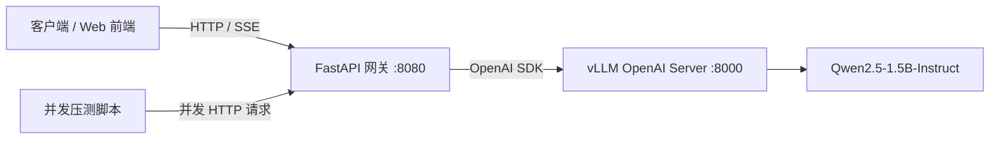

# vLLM + FastAPI 推理部署 Demo

一个用于学习和面试展示的小型大模型在线推理项目。vLLM 负责 GPU 推理与 OpenAI 兼容服务，FastAPI 作为业务网关，提供普通请求、SSE 流式输出、健康检查和并发压测。

## 1. 项目架构



请求链路：客户端调用 FastAPI → FastAPI 使用 OpenAI Python SDK 请求 vLLM 的 `/v1/chat/completions` → vLLM 调度 GPU 完成推理 → FastAPI 将结果以 JSON 或 SSE 返回。

## 2. 技术栈

- 模型服务：vLLM OpenAI-compatible server
- 示例模型：`Qwen/Qwen2.5-1.5B-Instruct`
- API 网关：FastAPI + Uvicorn
- 模型调用：OpenAI Python SDK（自定义 `base_url` 指向 vLLM）
- 流式协议：Server-Sent Events（SSE）
- 并发测试：Python asyncio + httpx
- 部署：Docker Compose

## 3. 环境要求

推荐在 Linux + NVIDIA GPU 环境运行，并提前安装 NVIDIA 驱动、Docker、Docker Compose 和 NVIDIA Container Toolkit。vLLM 对 CUDA、驱动和 GPU 架构有要求，具体以官方安装说明为准。

Windows 用户建议使用带 NVIDIA GPU 的 WSL2 Linux 环境，不建议直接在原生 Windows Python 环境安装 vLLM。没有 NVIDIA GPU 时，可以把 FastAPI 网关单独运行起来，但需要将 `VLLM_BASE_URL` 指向一台已经启动 vLLM 的远程 GPU 主机；本项目的 Compose 配置默认使用 NVIDIA GPU。

第一次启动需要从 Hugging Face 下载模型，耗时取决于网络和模型缓存情况。模型缓存保存在 Docker volume `hf-cache` 中。

## 4. 快速启动（推荐：Docker Compose）

```bash
# 1) 克隆项目并进入目录
git clone <你的仓库地址>
cd vllm-fastapi-demo

# 2) 创建环境变量文件
cp .env.example .env

# 3) 启动 vLLM 和 FastAPI
docker compose up --build -d

# 4) 查看日志（首次启动会下载模型并加载权重）
docker compose logs -f vllm
```

等待 vLLM 加载完成后检查：

```bash
curl http://localhost:8080/health
curl http://localhost:8000/v1/models \
  -H "Authorization: Bearer local-vllm-key"
```

预期 FastAPI 健康检查返回类似：

```json
{"status":"ready","model":"qwen2.5-1.5b"}
```

停止服务：

```bash
docker compose down
```

若要同时删除已下载的模型缓存（谨慎操作）：

```bash
docker compose down -v
```

## 5. 不使用 Docker：分别启动服务

### 5.1 启动 vLLM

请在满足 vLLM 安装要求的 Linux GPU 环境中，按官方文档安装 vLLM。然后执行：

```bash
export VLLM_API_KEY=local-vllm-key
vllm serve Qwen/Qwen2.5-1.5B-Instruct \
  --served-model-name qwen2.5-1.5b \
  --host 0.0.0.0 \
  --port 8000 \
  --api-key "$VLLM_API_KEY" \
  --max-model-len 4096 \
  --gpu-memory-utilization 0.85
```

参数说明：

- `--served-model-name`：设置 API 请求中使用的模型别名。
- `--host`、`--port`：监听地址和端口。
- `--api-key`：给 vLLM 接口增加简单的访问密钥；生产环境应使用安全的密钥管理方式。
- `--max-model-len`：限制最大上下文长度，降低显存压力。
- `--gpu-memory-utilization`：设置 vLLM 使用的 GPU 显存比例，需结合机器情况调整。

### 5.2 启动 FastAPI 网关

另开终端：

```bash
cd vllm-fastapi-demo
python -m venv .venv

# Linux / macOS
source .venv/bin/activate
# Windows PowerShell（仅用于运行网关；vLLM 仍建议运行在 Linux GPU 环境）
# .venv\Scripts\Activate.ps1

pip install -r api/requirements.txt
cp .env.example .env

# 如果 vLLM 不在本机，修改 .env 中的 VLLM_BASE_URL
uvicorn app.main:app --app-dir api --host 0.0.0.0 --port 8080 --reload
```

API 文档：<http://localhost:8080/docs>

## 6. API 使用方式

### 6.1 普通请求

```bash
curl -X POST http://localhost:8080/api/chat \
  -H "Content-Type: application/json" \
  -d '{
    "messages": [
      {"role": "system", "content": "你是一个简洁、专业的 AI 助手。"},
      {"role": "user", "content": "用通俗的话解释 vLLM。"}
    ],
    "temperature": 0.2,
    "max_tokens": 256
  }'
```

返回示例：

```json
{
  "id": "chatcmpl-...",
  "model": "qwen2.5-1.5b",
  "content": "vLLM 是一个用于大语言模型推理和服务的高性能引擎……",
  "finish_reason": "stop",
  "usage": {
    "prompt_tokens": 20,
    "completion_tokens": 48,
    "total_tokens": 68
  }
}
```

实际输出内容和 token 数量由模型生成结果决定，以上仅为格式示例。

### 6.2 流式请求（SSE）

```bash
curl -N -X POST http://localhost:8080/api/chat/stream \
  -H "Content-Type: application/json" \
  -d '{
    "messages": [
      {"role": "user", "content": "请分点解释大模型推理服务的流程。"}
    ],
    "temperature": 0.2,
    "max_tokens": 256
  }'
```

服务会持续返回 SSE 事件：

```text
data: {"delta": "大模型"}

data: {"delta": "推理服务"}

data: {"delta": "通常"}

data: [DONE]
```

前端可以使用 `fetch` 读取响应流，或根据项目需求使用 EventSource 的配套方案。这里使用 POST 请求，因此浏览器原生 `EventSource` 不直接适用。

### 6.3 直接验证 vLLM 的 OpenAI 兼容接口

```bash
pip install -r api/requirements.txt
python scripts/direct_vllm_test.py
```

该脚本绕过 FastAPI，直接通过 OpenAI Python SDK 调用 vLLM，验证 `/v1/chat/completions` 兼容接口。

## 7. 并发请求测试

安装网关依赖后执行：

```bash
# 10 个请求，最多 3 个并发
python scripts/load_test.py --requests 10 --concurrency 3

# 20 个请求，最多 5 个并发
python scripts/load_test.py --requests 20 --concurrency 5

# 对 SSE 流式接口做并发测试
python scripts/load_test.py --requests 10 --concurrency 3 --stream
```

脚本会统计成功/失败数量、总耗时、平均/最小/最大请求耗时、成功请求吞吐量（req/s）和输出字符数。压测结果受 GPU 型号、模型、输入长度、输出长度、显存、并发数和机器负载影响；请在 README 中记录自己实际测试的硬件和结果，不要预先填写虚构指标。

建议记录：

| GPU | 模型 | 并发数 | 请求数 | 平均延迟 | 吞吐量 | 成功率 |
|---|---|---:|---:|---:|---:|---:|
| 自行填写 | Qwen2.5-1.5B-Instruct | 3 | 10 | 实测 | 实测 | 实测 |

## 8. 目录结构

```text
vllm-fastapi-demo/
├── api/
│   ├── app/
│   │   ├── config.py
│   │   ├── main.py
│   │   └── schemas.py
│   ├── Dockerfile
│   └── requirements.txt
├── scripts/
│   ├── direct_vllm_test.py
│   └── load_test.py
├── .env.example
├── .gitignore
├── docker-compose.yml
└── README.md
```

## 9. 面试时可以这样介绍

“这个 Demo 主要实现了一个基于 vLLM 的大模型推理服务。底层使用 vLLM 加载 Qwen2.5-1.5B-Instruct，并启动 OpenAI 兼容接口；上层使用 FastAPI 封装业务 API，通过 OpenAI Python SDK 调用 vLLM。接口同时支持普通 JSON 返回和 SSE 流式输出。另外，我使用 asyncio 和 httpx 编写了并发压测脚本，可以调整并发数和请求数，统计延迟、吞吐量和失败情况。通过这个项目，我熟悉了模型服务启动、接口封装、流式响应以及基础并发测试的完整流程。”

## 10. 生产环境注意事项

这是学习和演示项目，不是开箱即用的生产系统。真实生产环境还应补充鉴权、限流、请求队列与超时控制、结构化日志、指标监控、审计、TLS、密钥管理、模型版本管理和多实例部署。不要把示例 API Key 或未经保护的 vLLM 端口直接暴露到公网。

## 11. 官方参考

- [vLLM Quickstart](https://docs.vllm.ai/en/stable/getting_started/quickstart/)
- [vLLM OpenAI-Compatible Server](https://docs.vllm.ai/en/stable/serving/openai_compatible_server/)
- [vLLM GPU Installation](https://docs.vllm.ai/en/latest/getting_started/installation/gpu/)
